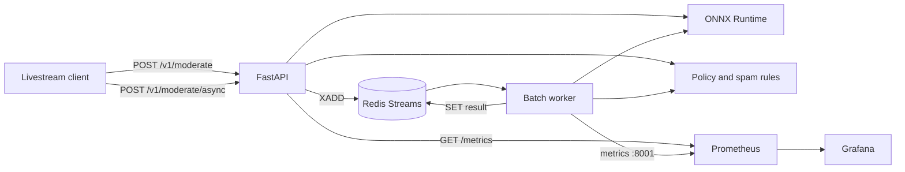

# Live Chat Moderation

Real-time toxicity, hate, and spam scoring for livestream chat. A small CPU-trained classifier is exported to ONNX and served from FastAPI, with a Redis Streams worker for batched traffic, Prometheus metrics, and a provisioned Grafana dashboard.

Numbers below were measured on this machine (4 vCPU, `Intel(R) Xeon(R) Processor`). Raw JSON is in `benchmarks/training.json` and `benchmarks/runtime.json`. The HTTP table is filled from a Locust run against `docker compose`.

## Resume bullets

- Built an end-to-end livestream comment moderation service: a CPU-trained multi-label toxicity model (Jigsaw, test mean ROC-AUC 0.953) exported to ONNX Runtime, with a sync FastAPI path and a Redis Streams micro-batch worker.
- Served an INT8 ONNX model (3.2 MB versus 12.8 MB FP32) whose in-process p99 is 0.09 ms; the forward pass is about 1.9× faster in ONNX Runtime than in PyTorch eager at one thread.
- Shipped Prometheus latency, error, decision, and PSI drift metrics with a provisioned Grafana dashboard, plus a Cloud Run deploy path that keeps CPU allocated so cold starts do not eat the 100 ms p99 budget.

## Architecture



The sync path scores one comment in the request. The async path enqueues onto a Redis stream; the worker waits a few milliseconds, batches whatever arrived, and runs one ONNX call for the group.

## Quickstart

```bash
python3 -m venv .venv
source .venv/bin/activate
pip install -e ".[dev]"
docker compose up --build -d
curl -s localhost:8000/health
curl -s localhost:8000/v1/moderate \
  -H 'content-type: application/json' \
  -d '{"text":"welcome to the stream","room_id":"live-1"}'
```

Grafana is at <http://localhost:3000> (anonymous view, admin password `admin`). Prometheus is at <http://localhost:9090>. These local credentials are for the demo stack only.

Retrain, including the ONNX export:

```bash
pip install -e ".[train]"
python scripts/train.py
python scripts/benchmark_runtimes.py
```

## API

| Method | Path | Role |
| --- | --- | --- |
| POST | `/v1/moderate` | Sync score, one comment |
| POST | `/v1/moderate/batch` | Sync score, up to 16 comments |
| POST | `/v1/moderate/async` | Enqueue, returns `202` and a job id |
| GET | `/v1/jobs/{job_id}` | Poll an async job |
| GET | `/v1/model` | Version, thresholds, held-out metrics |
| GET | `/v1/drift` | PSI versus the training reference |
| GET | `/metrics` | Prometheus |

`action` is `allow`, `review`, or `block`. `scores` are the product outputs `toxic`, `hate`, and `spam`. `attributes` are the six Jigsaw heads. Comment text is not logged.

## Design

The model is a mean-pooled word and word-bigram embedding with one hidden layer, trained on the Jigsaw Toxic Comment Classification Challenge (Wikipedia talk pages, mirrored at `Heliosoph/Jigsaw-Toxic-Comments`, revision `78e67fb`). That set has no spam labels, so spam is a separate high-precision rule stage (URLs, contact details, solicitation phrases, token floods). Block is reserved for high-precision toxicity, hate, and threats. Spam and borderline toxicity go to review.

Wikipedia comments are much longer than livestream chat (p90 is about 180 words). The encoder keeps 64 tokens, 48 from the head and 16 from the tail, then adds bigrams of that window. Short chat messages are not truncated. Thresholds are chosen on a stratified validation slice: block maximizes recall under a precision floor, review maximizes precision under a recall floor.

ONNX Runtime serves the model so the image does not ship PyTorch. INT8 dynamic quantization is exported and served only when the probability gap versus FP32 stays within 0.03. Intra-op threads are 1, and a semaphore caps concurrent session calls at the CPU count. Per-request logs are debug-level because writing a log line per comment moves latency more than this model does.

Drift is Population Stability Index on the toxic, hate, and spam scores against the validation histogram (10 equal-width bins). Under 0.1 is stable, 0.1 to 0.25 is moderate, above 0.25 is a real shift. Each process keeps its own window; a fleet would aggregate the same histograms.

## Layout

- `src/moderation/` serving library, API, and worker
- `scripts/train.py` download, train, calibrate, export
- `scripts/benchmark_runtimes.py` PyTorch versus ONNX versus INT8
- `deploy/` Prometheus, Grafana, Cloud Run script and notes
- `loadtest/locustfile.py` HTTP load test
- `models/` vocab, ONNX, thresholds, PSI reference (produced by training)

## Development

```bash
ruff check . && ruff format --check .
pytest
locust -f loadtest/locustfile.py --headless -u 20 -r 10 -t 45s --host http://127.0.0.1:8000
```

CI lints, runs pytest, and builds the image. GitHub Actions does not retrain; the exported model is part of the repo so the image is reproducible.

## Measured results

Hardware: 4 vCPU, `Intel(R) Xeon(R) Processor`. The training script, including data load, four epochs, the official test evaluation, and ONNX export, finished in 53 seconds.

### Model

Trained on 143,615 comments, validated on 15,956, and scored on the 63,978 Kaggle test rows that have labels. Vocabulary is 50,000 features. About 36% of Wikipedia comments are longer than the 64-token window; livestream chat usually is not.

| | ROC-AUC |
| --- | --- |
| Validation, mean of six heads | 0.967 |
| Official test, mean of six heads | 0.953 |
| Official test, `toxic` | 0.935 |
| Official test, `obscene` | 0.950 |
| Official test, `insult` | 0.948 |
| Official test, `threat` | 0.971 |
| Official test, `identity_hate` | 0.940 |
| Official test, `severe_toxic` | 0.975 |

The block threshold is chosen on validation only: toxic score ≥ 0.935 has validation precision 0.860 and recall 0.605. On the official test set that same threshold has block precision 0.624, recall 0.648, and blocks 4.2% of clean comments. Hate and threat auto-block barely add decisions (71 and 215 comments, against 6,483 toxic blocks). The gap is the Kaggle test distribution, not a threshold that was fit on the test labels. A production cutover would recalibrate on live traffic before raising the block rate.

Review-or-block on the test set catches 83.9% of labeled-bad comments. With the spam rules included, precision of that wider net is 0.353, because Wikipedia talk pages contain URLs the rules treat as spam. Model-only (spam disabled) flag precision is 0.423 at recall 0.833.

### PyTorch versus ONNX

Sequential `time.perf_counter` around the forward call, warmup 100, then 500 calls (batch 32: 125 calls). ORT intra-op threads = 1. PyTorch "1 thread" is `torch.set_num_threads(1)`.

| Runtime | Batch | p50 | p99 |
| --- | --- | --- | --- |
| PyTorch eager, 1 thread | 1 | 0.026 ms | 0.035 ms |
| ONNX Runtime FP32 | 1 | 0.014 ms | 0.020 ms |
| ONNX Runtime INT8 | 1 | 0.016 ms | 0.023 ms |
| PyTorch eager, 1 thread | 32 | 0.155 ms | 0.242 ms |
| ONNX Runtime FP32 | 32 | 0.145 ms | 0.192 ms |
| ONNX Runtime INT8 | 32 | 0.164 ms | 0.212 ms |
| Full engine (tokenize + INT8 + policy) | 1 | 0.062 ms | 0.093 ms |
| Full engine | 32 | 1.25 ms | 1.41 ms |

FP32 ONNX matches PyTorch logits within 4e-6. INT8 weights cut the file from 12.8 MB to 3.2 MB. The max probability gap on 256 validation rows is 0.025, under the 0.03 cutoff, so the service loads `model.int8.onnx`. INT8 is not faster here: almost all of the parameters are the embedding table, and dynamic quantization only rewrites the small linear layers. The size win is why it is the served file. Giving PyTorch every core made the batch-32 p99 worse (7.5 ms) because the thread pool adds noise on a model this small, which is why the server pins intra-op threads to 1.

### HTTP

Recorded from Locust against the compose stack. The table is updated from `benchmarks/loadtest.json` after that run.
